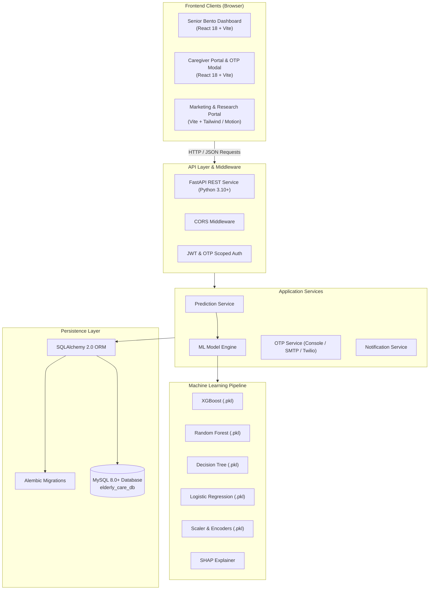
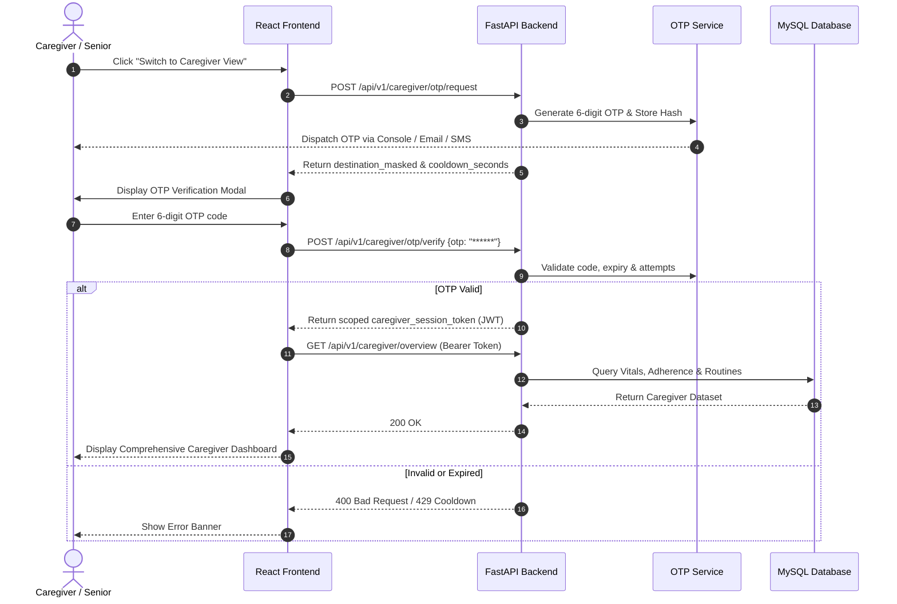

# SevaMitra AI (CarePulse) — Human-Centered Elderly Care & Remote Health Monitoring

[](https://www.python.org/)
[](https://fastapi.tiangolo.com/)
[](https://react.dev/)
[](https://vitejs.dev/)
[](https://www.mysql.com/)
[](https://scikit-learn.org/)
[](LICENSE)

**SevaMitra AI** is a production-grade, human-centered full-stack healthcare web application engineered specifically for senior citizens and family caregivers. Combining accessible Bento Grid UI design with authentic Machine Learning physiological stress and health risk prediction, persistent MySQL relational data storage, trilingual localization (English, Hindi, Marathi), and secure OTP-gated Caregiver oversight.

---

## 📑 Table of Contents

- [Problem Solved & Objectives](#-problem-solved--objectives)
- [Key Features](#-key-features)
- [System Architecture](#-system-architecture)
- [Application & Data Workflows](#-application--data-workflows)
- [Technology Stack](#-technology-stack)
- [Repository Structure](#-repository-structure)
- [Installation & Environment Setup](#-installation--environment-setup)
- [Running the Application](#-running-the-application)
- [Database Setup & Migrations](#-database-setup--migrations)
- [REST API Specifications](#-rest-api-specifications)
- [Automated Testing & Verification](#-automated-testing--verification)
- [Security Audit & Best Practices](#-security-audit--best-practices)
- [Known Limitations & Roadmap](#-known-limitations--roadmap)
- [Documentation Index](#-documentation-index)
- [License](#-license)

---

## 🎯 Problem Solved & Objectives

Elderly individuals frequently face technological and physical barriers when navigating modern digital health applications: small unreadable typography, complex multi-step navigation, language barriers, and fragmented medical data.

**SevaMitra AI addresses these challenges by delivering:**
1. **Zero-Friction Accessibility:** WCAG 2.1 AAA high-contrast layout, instantaneous 1-click text scaling (`100%`, `115%`, `130%`), and complete trilingual support (**English**, **हिंदी**, and **मराठी**).
2. **Predictive Biometric Health Intelligence:** Real pre-trained Machine Learning inference pipelines evaluating cardiovascular, respiratory, activity, and sleep biomarkers without simulated or randomized mock outputs.
3. **Dual Senior/Caregiver Operating Modes:** Seniors interact with an uncluttered, high-contrast daily dashboard while caregivers access an OTP-verified clinical administration console with remote medication oversight, vitals inspection, and emergency dispatch.
4. **Resilient Data Persistence:** Normalized relational schema running on MySQL with Alembic database migrations and diagnostic query suites for MySQL Workbench.

---

## 🌟 Key Features

### 1. Senior-Centric Interface
- **Bento Grid Dashboard:** High-contrast cards with generous touch targets, clear icons, and zero visual clutter.
- **Trilingual Accessibility:** Switch in real time between English, Hindi, and Marathi without page reloads.
- **Empathetic Activity Tracking:** Daily movement and step logging with positive, non-shaming motivational guidance.
- **One-Touch Emergency Card:** Direct caregiver notification with contact numbers and instant confirmation states.

### 2. Machine Learning Health Risk & Stress Engine
- **Pre-Trained Classifiers:** Powered by models trained on real physiological stress datasets (**XGBoost**, **Random Forest**, **Decision Tree**, **Logistic Regression**).
- **Clinical Feature Evaluation:** Heart Rate (BPM), Blood Oxygen (SpO₂ %), Daily Step Count, Sleep Duration (hours), Activity Level, and Stress Biomarker index.
- **Quantified Risk Scoring:** Computes risk probability percentages (0–100%) categorized into 4 risk tiers (*Low*, *Moderate*, *Elevated*, *Critical*).
- **Explainable AI (XAI):** Local feature attribution computed via SHAP.

### 3. Caregiver Mode & OTP Security
- **Scoped Verification:** Switching from Senior View to Caregiver Console triggers a secure 6-digit One-Time Password (OTP).
- **Multi-Channel Delivery:** Configurable delivery provider supporting local console logging (development), SMTP email, and Twilio SMS.
- **Caregiver Console:** Detailed senior vitals monitoring, anatomy symptom mapping, medication adherence audits, and daily routine schedules.

### 4. Medication & Routine Management
- **Medication Library & Schedules:** Daily dose tracking, meal associations (before/after food), and one-click "Mark as taken" logs.
- **Senior Permissions:** Seniors retain control over which health data points, routines, and contact details are shared with caregivers.

---

## 🏗️ System Architecture



---

## 🔄 Application & Data Workflows

### 1. Biometric Stress & Health Risk Prediction Flow

```mermaid
flowchart LR
    A["Senior Enters Vitals\n(Heart Rate, SpO2, Steps, Sleep)"] --> B["Frontend Validation\n(VitalsGrid / Modal)"]
    B --> C["POST /api/v1/predictions/stress\n(FastAPI)"]
    C --> D["Pydantic Schema Validation\n(Biometric Feature Bounds)"]
    D --> E["ModelService\n(Feature Scaling & Encoding)"]
    E --> F["ML Inference Engine\n(XGBoost / Random Forest)"]
    F --> G["Compute Probability &\nRisk Tier (0-100%)"]
    G --> H["SHAP Local Feature\nAttribution Explainer"]
    H --> I["Store Record in MySQL\n(health_predictions table)"]
    I --> J["Render Bento Card\nWith Tailored Health Guidance"]
```



### 2. Senior-to-Caregiver Mode Switching & OTP Verification Flow



---

## 💻 Technology Stack

| Layer | Technologies | Description |
| :--- | :--- | :--- |
| **Frontend Web App** | React 18, Vite 5, JavaScript (ES6+), CSS3 Design Tokens | High-contrast Bento Grid dashboard with Devanagari typography support. |
| **Research Landing** | React, TypeScript, Tailwind CSS, Lucide Icons, Framer Motion | Research overview and public portal located in `langing page/`. |
| **Backend API** | Python 3.10+ (tested on 3.14.3), FastAPI, Uvicorn, Pydantic v2 | High-throughput asynchronous REST API with auto-generated OpenAPI docs. |
| **Machine Learning** | Scikit-learn, XGBoost, SHAP, Pandas, NumPy, Joblib | Pre-trained classification pipelines with local feature attribution. |
| **Database & ORM** | MySQL 8.0+, SQLAlchemy 2.0, Alembic, PyMySQL | Normalized relational database schema with versioned migrations. |
| **Security & Auth** | Passlib (Bcrypt), PyJWT, Scoped Bearer Tokens, OTP | Role-gated authentication and session isolation. |
| **Automation** | PowerShell Core / Windows PowerShell | Automated startup, diagnostics, test verification, and database backups. |

---

## 📁 Repository Structure

```
Human-Centered AI Elderly Care Websit/
├── .env.example                     # Environment configuration template (sanitized)
├── .gitignore                       # Git ignore rules for Python, Node, and secrets
├── README.md                        # Primary project documentation
├── start.ps1                        # Single-command Windows launcher script
├── Human-Centered AI...Proposal.pdf # Research proposal document
│
├── frontend/                        # React + Vite Senior & Caregiver Application
│   ├── index.html                   # HTML entry point with accessibility viewport
│   ├── package.json                 # Frontend dependencies (React 18, Lucide)
│   ├── vite.config.js               # Vite build configuration & dev proxy
│   └── src/
│       ├── App.jsx                  # Main application router and state management
│       ├── main.jsx                 # React root renderer
│       ├── components/              # UI Components (Modals, Bento Cards, Grids)
│       ├── hooks/                   # useTranslation, useFontSize custom hooks
│       ├── pages/                   # DashboardView, CaregiverDashboardView, etc.
│       ├── services/                # api.js centralized backend integration client
│       ├── styles/                  # High-contrast CSS3 design system
│       └── translations/            # English, Hindi, and Marathi localization files
│
├── backend/                         # FastAPI Application & Machine Learning Suite
│   ├── alembic.ini                  # Database migration configuration
│   ├── requirements.txt             # Python backend dependencies
│   ├── app/
│   │   ├── main.py                  # FastAPI application entry point & CORS
│   │   ├── api/                     # REST route handlers
│   │   │   ├── deps.py              # Auth dependencies & database sessions
│   │   │   └── v1/endpoints/        # auth, predictions, medicines, caregiver, etc.
│   │   ├── core/                    # App config, environment loading, JWT & bcrypt
│   │   ├── database/                # SQLAlchemy database session & Base engine
│   │   ├── models/                  # SQLAlchemy ORM database models
│   │   ├── schemas/                 # Pydantic request and response schemas
│   │   └── services/                # ML ModelService, PredictionService, OTPService
│   ├── ml/                          # Machine Learning Artifacts
│   │   ├── models/                  # xgboost.pkl, random_forest.pkl, decision_tree.pkl, etc.
│   │   ├── preprocessing/           # scaler.pkl, encoder.pkl, background_sample.pkl
│   │   └── utils/                   # Feature preprocessing utilities
│   ├── migrations/                  # Alembic database migration scripts
│   └── tests/                       # Pytest test suite (19 test cases)
│       ├── test_api_endpoints.py    # Health checks, prediction API, and validation
│       ├── test_caregiver_otp.py    # Caregiver auth, OTP flows, and access control
│       └── test_ml_integration.py   # Machine learning inference benchmarks
│
├── docs/                            # In-Depth Project Documentation
│   ├── SETUP.md                     # Step-by-step Windows setup guide
│   ├── DATABASE.md                  # MySQL configuration and schema reference
│   ├── API.md                       # Comprehensive REST API specifications
│   ├── DEPLOYMENT.md                # Production hosting and server deployment guide
│   ├── TEST_REPORT.md               # Automated verification and benchmark report
│   └── database_queries.sql         # Diagnostic SQL queries for MySQL Workbench
│
├── scripts/                         # PowerShell Automation Suite
│   ├── check.ps1                    # Environment diagnostic tool (Python, Node, MySQL)
│   ├── test.ps1                     # Automated test runner (Pytest + Vite Build)
│   ├── stop.ps1                     # Clean process shutdown utility
│   └── backup-db.ps1                # Automated MySQL database backup utility
│
└── langing page/                    # Research and Marketing Landing Page Application
    ├── index.html                   # Landing page entry point
    ├── package.json                 # Landing page dependencies
    ├── vite.config.ts               # Vite TypeScript configuration
    └── src/                         # Landing page sections, themes, and components
```

---

## ⚙️ Installation & Environment Setup

### 1. Prerequisites
- **Python 3.10+** (Tested on Python 3.14.3)
- **Node.js 18+** & **npm** (Tested on Node v24.19.0)
- **MySQL Server 8.0+** & **MySQL Workbench**

### 2. Clone and Configure Environment

```bash
git clone <repository-url>
cd "Human-Centered AI Elderly Care Websit"
```

Create your local `.env` file from the sanitized template:

```powershell
Copy-Item .env.example .env
```

Open `.env` in any editor and set your database credentials and secret key:

```env
PROJECT_NAME="SevaMitra AI - Human-Centered Elderly Care"
VERSION=2.0.0
PORT=8000
HOST=0.0.0.0

# MySQL Database Connection
MYSQL_HOST=localhost
MYSQL_PORT=3306
MYSQL_DB=elderly_care_db
MYSQL_USER=elderly_care_user
MYSQL_PASSWORD=YourSecurePasswordHere

# Security
SECRET_KEY=your_secure_random_key_min_32_characters
ALGORITHM=HS256
ACCESS_TOKEN_EXPIRE_MINUTES=10080

# Caregiver OTP Configuration
OTP_EXPIRY_MINUTES=5
OTP_MAX_ATTEMPTS=3
OTP_DELIVERY_PROVIDER=console
```

### 3. Install Python Dependencies

```powershell
# Create or activate your virtual environment
python -m venv venv
.\venv\Scripts\Activate.ps1

# Install required packages
pip install -r backend/requirements.txt
```

### 4. Install Frontend Dependencies

```powershell
cd frontend
npm install
cd ..
```

---

## 🚀 Running the Application

### Option A: One-Command Windows Launcher (Recommended)

Simply execute the root launcher script in PowerShell:

```powershell
.\start.ps1
```

The script will:
1. Verify Python, Node, and port availability (8000, 5173).
2. Check MySQL connectivity and apply any pending Alembic migrations.
3. Launch the FastAPI backend server on `http://127.0.0.1:8000`.
4. Launch the Vite React frontend on `http://localhost:5173`.
5. Open your default web browser automatically.

### Option B: Manual Execution

**Start the Backend:**
```powershell
uvicorn backend.app.main:app --host 127.0.0.1 --port 8000 --reload
```

**Start the Frontend:**
```powershell
cd frontend
npm run dev
```

### Access URLs:
- **Senior & Caregiver Application:** [http://localhost:5173](http://localhost:5173)
- **FastAPI Backend Root:** [http://127.0.0.1:8000](http://127.0.0.1:8000)
- **Interactive Swagger Documentation:** [http://127.0.0.1:8000/docs](http://127.0.0.1:8000/docs)
- **System Health & Readiness Endpoint:** [http://127.0.0.1:8000/health/ready](http://127.0.0.1:8000/health/ready)

### Safe Shutdown:
```powershell
.\scripts\stop.ps1
```

---

## 🗄️ Database Setup & Migrations

The project utilizes MySQL 8.0+ for all persistent entities.

### 1. Database Creation
In MySQL Workbench or the MySQL command-line client, run:

```sql
CREATE DATABASE IF NOT EXISTS elderly_care_db CHARACTER SET utf8mb4 COLLATE utf8mb4_unicode_ci;
CREATE USER IF NOT EXISTS 'elderly_care_user'@'localhost' IDENTIFIED BY 'YourSecurePasswordHere';
GRANT ALL PRIVILEGES ON elderly_care_db.* TO 'elderly_care_user'@'localhost';
FLUSH PRIVILEGES;
```

### 2. Applying Migrations
Apply version-controlled schema migrations using Alembic:

```powershell
alembic -c backend/alembic.ini upgrade head
```

### 3. Diagnostic Queries
Open `docs/database_queries.sql` in MySQL Workbench to run pre-built diagnostic queries for inspecting:
- User profiles and access roles
- Logged health risk predictions
- Medication schedules and adherence records
- Activity logs and daily routines

---

## 📡 REST API Specifications

The FastAPI backend exposes structured REST endpoints documented automatically via OpenAPI at `/docs`.

### Key Endpoints Overview

| Method | Endpoint | Description | Auth Required |
| :--- | :--- | :--- | :---: |
| `GET` | `/health` | Liveness health check | No |
| `GET` | `/health/ready` | Readiness check verifying MySQL and ML model loading | No |
| `POST` | `/api/v1/auth/register` | Senior / Caregiver account registration | No |
| `POST` | `/api/v1/auth/login` | User authentication & JWT issuance | No |
| `POST` | `/api/v1/predictions/stress` | Multi-model physiological stress & risk prediction | Optional |
| `GET` | `/api/v1/dashboard/summary` | Consolidated vitals, medications, and activity status | Optional |
| `GET` | `/api/v1/medicines/today` | List active medications scheduled for today | Optional |
| `POST` | `/api/v1/medicines/log` | Record medication taken/skipped status | Optional |
| `POST` | `/api/v1/caregiver/otp/request` | Request 6-digit OTP for caregiver access | No |
| `POST` | `/api/v1/caregiver/otp/verify` | Verify OTP and issue caregiver session token | No |
| `GET` | `/api/v1/caregiver/overview` | Detailed senior oversight metrics | Bearer (Caregiver) |
| `GET` | `/api/v1/caregiver/permissions` | Inspect senior data sharing permissions | Bearer (Caregiver) |

Detailed request/response schemas and examples are provided in [docs/API.md](docs/API.md).

---

## 🧪 Automated Testing & Verification

The project includes an automated test suite across backend API endpoints, machine learning inference benchmarks, and the frontend Vite production build.

Run all automated tests via the verification script:

```powershell
.\scripts\test.ps1
```

Or execute pytest directly:

```powershell
pytest backend/tests -v
```

### Verification Results Summary (20/20 Passed):
- **Machine Learning Integration (`backend/tests/test_ml_integration.py`):** 5 tests passed (model loading, multi-model inference, physiological boundary validation, SHAP explainability).
- **REST API Endpoints (`backend/tests/test_api_endpoints.py`):** 7 tests passed (health probes, stress predictions, input error handling, dashboard payloads, medicine queries).
- **Caregiver Mode & OTP Security (`backend/tests/test_caregiver_otp.py`):** 7 tests passed (unauthorized access denial, OTP issuance, invalid code rejection, scoped session tokens, contacts, and routines).
- **Frontend Production Build:** Vite build completed with zero errors in ~2.1s (`dist/index.html`, minified CSS/JS chunks).

Detailed verification logs and execution reports are available in [docs/TEST_REPORT.md](docs/TEST_REPORT.md).

---

## 🔒 Security Audit & Best Practices

1. **Environment Variables & Secrets:** All database credentials, JWT secrets, and notification tokens are loaded through `.env`. The template `.env.example` contains only generic placeholder values.
2. **Git Ignore Configuration:** `.gitignore` excludes `.env`, `node_modules/`, `dist/`, `.pytest_cache/`, `*.log`, and database backups.
3. **Password Hashing:** Passwords are never stored in plaintext; user credentials use `bcrypt` via Passlib.
4. **Scoped Tokens:** Caregiver administrative capabilities require short-lived, OTP-verified JWT tokens with explicit expiration intervals.
5. **No Production Exposure:** Prior commits and working files have been audited to ensure no live production API keys or proprietary keys are tracked.

---

## 🗺️ Known Limitations & Roadmap

- **Mock Session Memory Fallback:** When MySQL Server is stopped, the backend operates in an in-memory session mode to allow frontend UI evaluation. For full multi-user persistence, MySQL must be active.
- **Hardware Integration:** Current vitals input supports manual entry and simulated smart band payloads; direct Bluetooth LE (BLE) wearable pairing is planned for future releases.
- **Push Notifications:** Web Push / Service Worker integration for proactive senior medication reminders is in active development.

---

## 📚 Documentation Index

- [First-Time Windows Setup Guide](docs/SETUP.md)
- [Database Configuration & MySQL Workbench Guide](docs/DATABASE.md)
- [REST API Specifications & Schemas](docs/API.md)
- [Automated Verification & Test Report](docs/TEST_REPORT.md)
- [Production Deployment Guide](docs/DEPLOYMENT.md)
- [Diagnostic MySQL Queries](docs/database_queries.sql)

---

## 📄 License

This project is licensed under the [MIT License](LICENSE) — see the LICENSE file for details.
